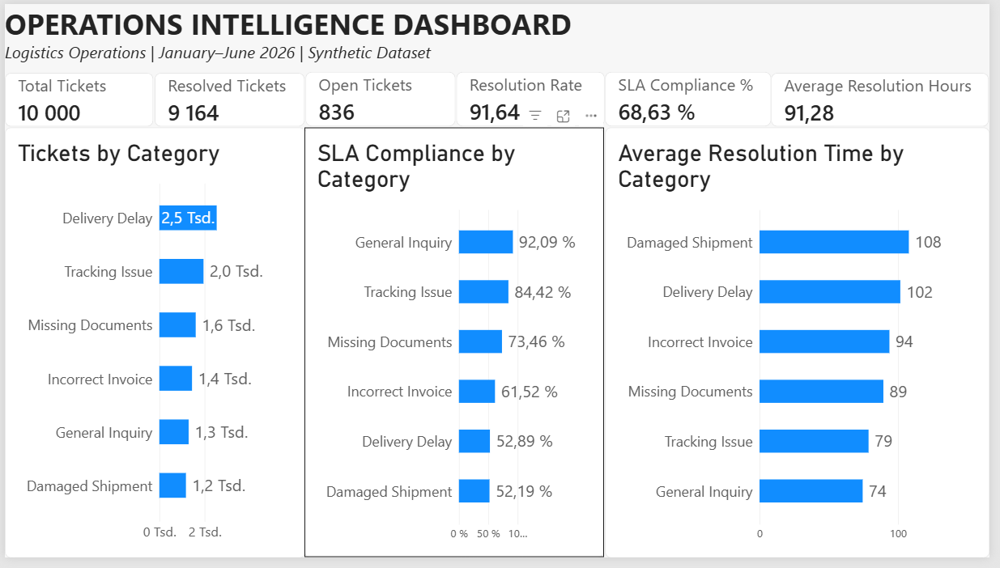
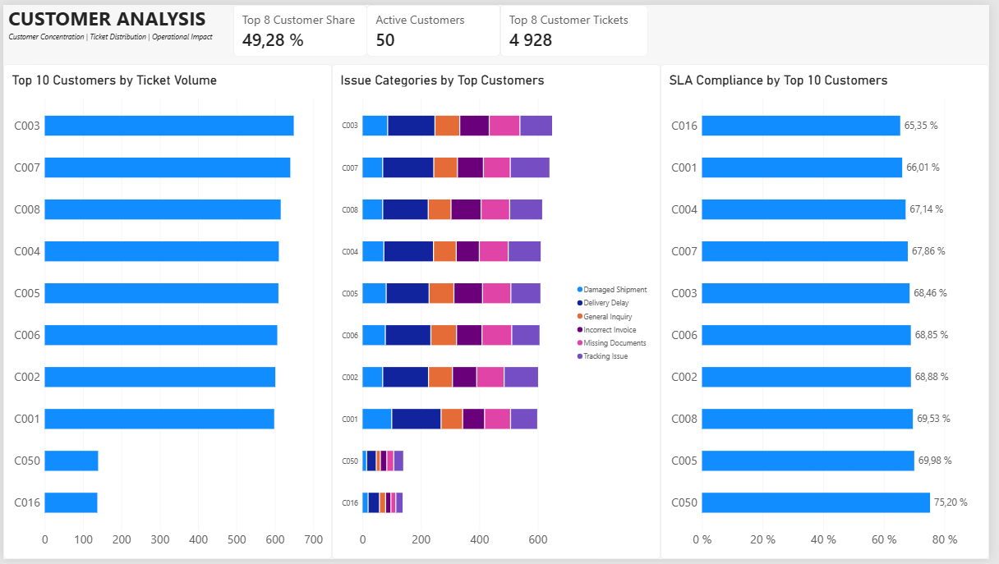
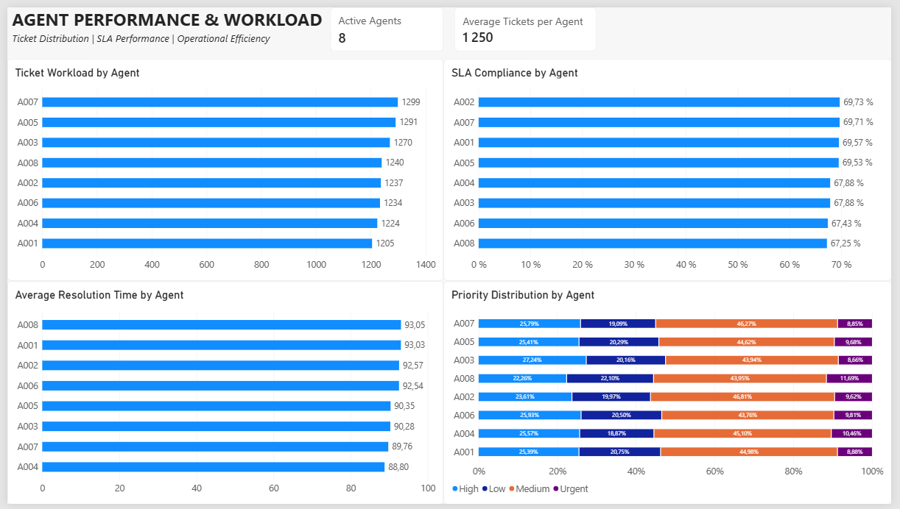
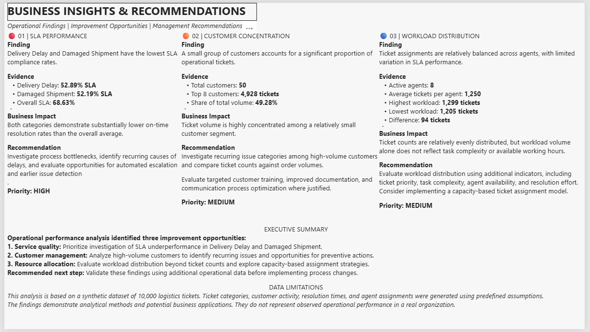

# Operations Intelligence Dashboard

### Logistics Operations Analysis | Python · SQL · Power BI

## Project Overview

This project demonstrates an end-to-end data analytics workflow using a synthetic logistics ticketing dataset.

The objective is to analyze operational performance, identify potential process improvement opportunities, and present actionable business insights through an interactive Power BI dashboard.

The dataset contains 10,000 simulated support tickets covering January to June 2026.

## Business Objectives

The analysis focuses on four questions:

1. How efficiently are operational tickets resolved?
2. Which issue categories contribute to SLA underperformance?
3. How is ticket volume distributed across customers?
4. How are tickets and priorities distributed across agents?

## Technologies Used

**Python**
- Synthetic data generation
- Data validation using Pandas
- Operational KPI calculations

**SQL / SQLite**
- Relational database creation
- Data aggregation and filtering
- JOIN operations
- Common Table Expressions (CTEs)

**Power BI**
- Data transformation using Power Query
- DAX measures
- Interactive dashboards
- Operational performance visualization

## Analytical Workflow

1. Generate synthetic logistics ticket data.
2. Validate data quality and consistency.
3. Calculate operational performance indicators using Python.
4. Import data into SQLite and perform SQL analysis.
5. Validate KPI results across analytical tools.
6. Build interactive Power BI dashboards.
7. Interpret findings and develop business recommendations.

## Dashboard Pages

### 1. Operational Overview

Overview of ticket volumes, resolution rates, SLA compliance, resolution times, and issue categories.

### 2. Customer Analysis

Analysis of customer ticket concentration, issue categories, and SLA compliance.

### 3. Agent Performance & Workload

Comparison of ticket assignments, SLA performance, resolution times, and priority distribution across agents.

### 4. Business Insights & Recommendations

Summary of operational findings, improvement opportunities, and recommendations for management.

## Key Findings

| KPI | Result |
|---|---:|
| Total Tickets | 10,000 |
| Resolved Tickets | 9,164 |
| Open Tickets | 836 |
| Resolution Rate | 91.64% |
| SLA Compliance | 68.63% |
| Average Resolution Time | 91.28 hours |
| Active Customers | 50 |
| Top 8 Customer Ticket Share | 49.28% |
| Active Agents | 8 |

### Finding 1: SLA Underperformance

Delivery Delay and Damaged Shipment have the lowest SLA compliance rates, at approximately 53% and 52%, respectively.

**Recommendation:** Investigate process bottlenecks and evaluate automated escalation opportunities.

### Finding 2: Customer Concentration

Eight customers account for 49.28% of all tickets.

**Recommendation:** Analyze recurring issues and compare ticket volumes with order volumes before determining whether targeted preventive measures are justified.

### Finding 3: Workload Distribution

Ticket assignments are relatively balanced across eight agents.

**Recommendation:** Evaluate capacity-based assignment strategies that consider working hours, ticket priority, and task complexity rather than ticket counts alone.

## Data Limitations

This project uses synthetic data generated with predefined assumptions.

Customer activity, issue categories, resolution times, and agent assignments are simulated. Findings therefore illustrate analytical techniques and potential business applications rather than measured performance in a real organization.

Ticket volume alone does not establish customer error rates or employee productivity.

## Project Purpose

This project was developed as part of a professional portfolio focused on data analytics, business intelligence, process optimization, and operational automation.